## hello world! 👋 angelo here 🐺

* 👨‍💻 Would like to be called **Al** or **Angelo** that would be awesome.
* 💻 Full-stack web dev, these days mostly on Laravel + Vue.
* 🐱 I like cats but I don't have one... I like to believe Schrödinger's cat is alive and theoretically make it as my own cat.
* 🎶 More into mainstream pop girls ifykim (olivia, taylor, chappell, etc.)
* 🎬 I like films! Check my [Letterboxd](https://letterboxd.com/blaterwolf/) account if you're interested with my quirky, serious, and maybe even fun one-liner reviews from my personal 5⭐ films to the worst ones.
* 📬 Reach me at: blaterwolf.works@gmail.com

#### Spotify Playing 🎧

<!-- The now-playing card goes back here once the widget is redeployed. -->

  

#### Recently Watched 🎬

Straight from my [Letterboxd diary](https://letterboxd.com/blaterwolf/films/diary/), refreshed daily by a robot:

<table>
<tr>
<!-- LETTERBOXD:START -->
<td align="center"> ½</td>
<td align="center"> ★</td>
<td align="center"> ★★★½</td>
<td align="center"> ★★★★★</td>
<td align="center"> ★★★★★</td><!-- LETTERBOXD:END -->
</tr>
</table>

#### Programming Tools 🔧

**Daily drivers**

       

**Where I started**

    

**Always open**

   

#### My Stats 📈

  

  
  

